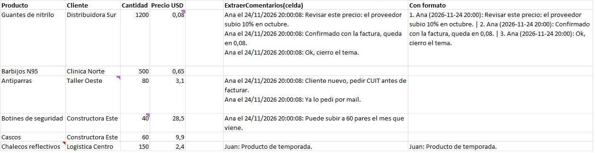
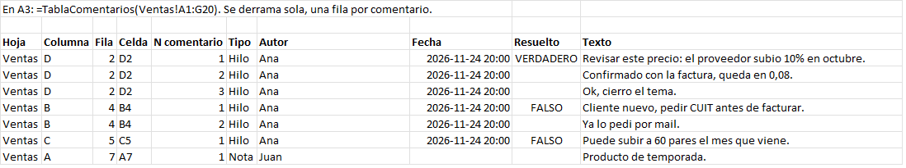

# 📝 Excel VBA: extraer comentarios

**[Read in English](README.md)**

Excel no tiene una fórmula para leer los comentarios de una celda. Este módulo suma tres formas de traerlos a la grilla, para buscarlos, filtrarlos, contarlos y exportarlos:

| Herramienta | Qué te da | Versión de Excel |
|---|---|---|
| `=ExtraerComentarios(celda)` | Todos los comentarios de **una celda**, como texto en esa celda | Cualquiera |
| `=TablaComentarios([rango])` | Una **tabla**, una fila por comentario o respuesta, que se derrama sola | Excel 365 / 2021 (matrices dinámicas) |
| `ExportarComentarios` (macro) | La misma tabla con **todas las hojas del libro**, en una hoja nueva como tabla de Excel | Cualquiera |

Los alias en inglés hacen lo mismo con encabezados en inglés: `=ExtractComments()`, `=CommentsTable()` y la macro `ExportComments`.

Lee los dos tipos de comentarios de Excel: los **comentarios en hilo** (los modernos, con respuestas) y las **notas** (el recuadro amarillo clásico). Si la celda no tiene comentarios, la función la deja vacía, sin error.

---

## 1. Una celda: `=ExtraerComentarios()`

<p align="center">
  
</p>

```
=ExtraerComentarios(D2)
=ExtraerComentarios(D2; "{n}. {author} ({date}): {text}"; " | ")
=ExtraerComentarios(A7; "{author}: {text}")
```

(En Excel en castellano los argumentos se separan con `;`; en inglés, con `,`.)

| Argumento | Obligatorio | Qué hace |
|---|---|---|
| `celda` | sí | La celda de la que querés los comentarios. Si pasás un rango, usa solo la primera celda. |
| `formato` | no | Una plantilla para cada comentario, con `{author}`, `{date}` (`aaaa-mm-dd hh:mm`), `{text}` y `{n}` (1 es el hilo, 2 en adelante son las respuestas). Sin plantilla, la salida es la original: `Autor el fecha: texto`. |
| `separador` | no | Lo que va entre un comentario y el siguiente. Por defecto, un salto de línea (activá *Ajustar texto* para verlo). |

## 2. Una tabla que se derrama: `=TablaComentarios()`

<p align="center">
  
</p>

```
=TablaComentarios()                  todos los comentarios de la hoja donde está la fórmula
=TablaComentarios(Ventas!A1:G20)     solo los comentarios que caen dentro de ese rango
```

Se escribe en una celda y Excel completa solo las filas de abajo, con encabezados. Dejá espacio libre abajo y a la derecha, o vas a ver `#¡DESBORDAMIENTO!`. Dale formato de fecha a la columna `Fecha` para leerla (Excel devuelve las fechas de una función como números).

## 3. Todo el libro: la macro `ExportarComentarios`

<p align="center">
  
</p>

Se corre desde **Programador > Macros** (o `Alt + F8`): elegís `ExportarComentarios` y **Ejecutar**. Recorre todas las hojas y escribe todos los comentarios en una hoja llamada **Comentarios** (si ya existe, la reemplaza, nunca duplica) como tabla de Excel llamada `tblComentarios`, con las fechas con formato y el texto ajustado. Desde ahí, una tabla dinámica responde cosas como *quién comenta más*, *hilos abiertos por hoja* o *promedio de comentarios por celda*.

### Las columnas de la tabla

| Columna | Ejemplo | Para qué |
|---|---|---|
| `Hoja` | `Ventas` | Filtrar por hoja |
| `Columna` | `D` | Indexar por letra de columna |
| `Fila` | `2` | Indexar por número de fila |
| `Celda` | `D2` | La clave para volver a cruzar con los datos |
| `N comentario` | `1`, `2`, `3` | `1` es el hilo; el resto, las respuestas en orden |
| `Tipo` | `Hilo` / `Nota` | Comentario en hilo o nota clásica |
| `Autor` | `Ana` | Quién lo escribió |
| `Fecha` | `2026-11-24 20:00` | Cuándo. Las notas no tienen fecha en Excel, así que queda vacía |
| `Resuelto` | `VERDADERO` / `FALSO` | Solo en el primer comentario de un hilo. Vacío en respuestas y notas |
| `Texto` | `Revisar este precio` | El comentario. En las notas, sin el renglón `Autor:` que Excel agrega arriba |

Las filas salen ordenadas por hoja, fila, columna y número de comentario.

---

## ¿Cuál uso?

| Tu situación | Usá |
|---|---|
| Querés **leer** los comentarios al lado de los datos, fila por fila, o copiarlos a un informe | **La función** `=ExtraerComentarios()` |
| Querés los comentarios de **una hoja** como tabla dentro de tu modelo, junto a otras fórmulas (`FILTRAR`, `CONTAR.SI`, `BUSCARX`) | **La función que se derrama** `=TablaComentarios()` (Excel 365 / 2021) |
| Querés **todas las hojas** juntas, una **tabla dinámica**, **mandarle** los comentarios a alguien, o tenés un Excel sin matrices dinámicas | **La macro** `ExportarComentarios` |
| El libro es **grande** (miles de comentarios) | **La macro**: lee todo una vez y lo escribe de una sola vez. Muchas funciones arrastradas se recalculan de a una. |
| Necesitás una **foto fija** que no cambie (por ejemplo, una auditoría de cierre de mes) | **La macro**: su resultado son valores en una tabla, no fórmulas. |
| El libro se va a **compartir con gente que desactiva las macros** | Corré la macro y guardá una copia como `.xlsx`: la tabla queda y el código se va. |

En una línea: **la función para leer, la macro para analizar.**

---

## Instalación

**Opción A, importar el archivo (recomendada):**
1. Descargá [`VBA-comment-extractor.bas`](VBA-comment-extractor.bas).
2. En Excel, `Alt + F11` abre el editor de VBA.
3. **Archivo > Importar archivo...** y elegí el `.bas`. Aparece un módulo llamado `ExtractorComentarios`.
4. Cerrá el editor y usá las funciones en cualquier celda.

**Opción B, copiar y pegar:** abrí el `.bas`, copiá todo **desde el segundo renglón** (el primero, `Attribute VB_Name`, sirve solo para importar) y pegalo en un módulo nuevo (**Insertar > Módulo**).

Guardá el libro como **Libro de Excel habilitado para macros (`.xlsm`)**, o el código se pierde.

**Probalo antes sin instalar nada:** descargá [`example/comments-example.xlsm`](example/comments-example.xlsm). Tiene datos inventados, comentarios en hilo con respuestas, notas, las tres herramientas ya funcionando y el módulo de pruebas. Excel te va a pedir que habilites las macros.

---

## Cómo se actualiza

Excel **no recalcula una fórmula cuando cambia un comentario**: agregar o editar un comentario no es un cambio en ninguna celda. Después de tocar comentarios, apretá **`Ctrl + Alt + F9`** (recálculo completo) para actualizar `ExtraerComentarios` y `TablaComentarios`. La macro simplemente se vuelve a correr.

Las funciones **no son volátiles** (`Application.Volatile`) a propósito. Ver *Problemas que encontramos*, más abajo.

## Límites

- **Las notas no tienen fecha** en Excel, y su autor es solo el nombre visible de quien la creó.
- **Los comentarios en hilo se crean en Microsoft 365.** En versiones anteriores, Excel los muestra como notas y las herramientas los leen como notas.
- **`TablaComentarios` necesita matrices dinámicas** (Excel 365 o 2021). En versiones anteriores, usá la macro.
- **La función lee una sola celda.** Si le pasás `A1:C10`, mira solo `A1`.
- **Resuelto** existe solo en comentarios en hilo, y solo en el primero del hilo.

## Problemas que encontramos al armarlo

- **Una función volátil que lee comentarios puede hacer caer a Excel al abrir el libro.** Con `Application.Volatile`, Excel recalcula la función de tabla mientras todavía está cargando los comentarios del archivo, y en nuestras pruebas Excel se cerraba cada vez que abría el ejemplo. Sin `Volatile` abrió siempre. Por eso las funciones no son volátiles y el README pide `Ctrl + Alt + F9`.
- **Una tabla de Excel no puede llamarse igual que una función.** La primera versión llamaba `TablaComentarios` a la tabla de la macro, igual que la función, y el libro dejó de abrir. Ahora la tabla es `tblComentarios` (`tblComments` en inglés).
- **Excel crea una nota oculta por cada comentario en hilo.** Si se leen las dos colecciones, cada hilo se cuenta dos veces. Las notas que pertenecen a un hilo se saltean.
- **Las notas empiezan con `Autor:`.** La tabla saca ese renglón porque el autor ya tiene su columna. La función de una celda mantiene el comportamiento original, salvo que le pases un formato.

---

## Pruebas

[`tests/PruebasExtractor.bas`](tests/PruebasExtractor.bas) tiene 22 comprobaciones que corren dentro de Excel sobre el libro de ejemplo: el texto de una celda, las celdas vacías, el formato y el separador propios, el orden y la numeración de la tabla, *Resuelto*, las notas sin fecha, que los hilos no se cuenten dos veces, un rango sin comentarios, los encabezados en inglés, y la macro (cantidad de filas, tabla de Excel, fechas de verdad y que correrla dos veces no duplique). Importalo junto al módulo principal y corré la función `ProbarExtractor` desde la ventana Inmediato (`Ctrl + G`):

```
? ProbarExtractor()
```

Última corrida: **22 de 22 OK** en Excel para Microsoft 365 (Windows).

---

## Cambios

**v2.0 (noviembre de 2026)**
- Nuevo: `=TablaComentarios()`, una tabla que se derrama, una fila por comentario o respuesta.
- Nuevo: la macro `ExportarComentarios`, todas las hojas en una tabla de Excel.
- Nuevo: alias en inglés `ExtractComments`, `CommentsTable` y `ExportComments`, con encabezados en inglés.
- Nuevo: `formato` y `separador` opcionales en la función de una celda.
- Nuevo: un libro de ejemplo y un módulo de pruebas.
- Cambio: el separador por defecto es un salto de línea (`vbLf`) en vez de `vbCrLf`, que Excel muestra mejor dentro de una celda.

**v1.0**: `=ExtraerComentarios(celda)`.

## Hoja de ruta

- [x] Un comentario por fila, como macro y como función que se derrama.
- [x] Alias en inglés.
- [x] Un `.xlsm` de ejemplo con comentarios de prueba.
- [x] Formato propio para la función de una celda.
- [ ] Una macro `ImportarComentarios`, el camino de vuelta: editar la tabla y escribir los comentarios en las celdas.
- [ ] Filtrar la macro por hoja o por fecha.
- [ ] Una hoja con una tabla dinámica ya armada en el ejemplo.

Las sugerencias son bienvenidas como [issues](https://github.com/mauroemartinez/VBA-extract-comments-function/issues).

## Licencia

[MIT](LICENSE).
