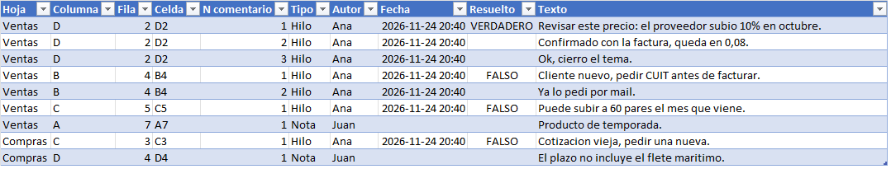

# 📝 Excel VBA: extraer, analizar y devolver los comentarios de las celdas
<p>
  <a href="README.md"></a>
  <a href="README.es.md"></a>
</p>

> **Excel no tiene una fórmula para leer los comentarios de una celda. Este módulo los trae a la grilla, donde se pueden buscar, filtrar, contar y analizar con una tabla dinámica, y devuelve a las celdas lo que edites.**

[](VBA-comment-extractor.bas)
[](#-cuál-uso)
[](#-pruebas)
[](https://github.com/mauroemartinez/VBA-extract-comments-function/releases)
[](LICENSE)
[](https://github.com/mauroemartinez/VBA-extract-comments-function/commits/main)

<p align="left">
  <a href="#-las-herramientas">🧰 Herramientas</a> ·
  <a href="#-cuál-uso">🧭 Cuál uso</a> ·
  <a href="#%EF%B8%8F-instalación">⬇️ Instalación</a> ·
  <a href="#-las-columnas-de-la-tabla">📋 Columnas</a> ·
  <a href="#-cómo-se-actualiza-y-límites">🔁 Límites</a> ·
  <a href="#%EF%B8%8F-problemas-que-encontramos-al-armarlo">🛠️ Lecciones</a> ·
  <a href="#-pruebas">✅ Pruebas</a> ·
  <a href="#%EF%B8%8F-cambios">🗒️ Cambios</a>
</p>

---

## 🧰 Las herramientas

| Herramienta | Qué te da | Versión de Excel |
|---|---|---|
| `=ExtraerComentarios(celda)` | Todos los comentarios de **una celda**, como texto en esa celda | Cualquiera |
| `=TablaComentarios([rango])` | Una **tabla**, una fila por comentario o respuesta, que se derrama sola | 365 / 2021 |
| `ExportarComentarios` (macro) | Todos los comentarios de **todas las hojas**, en una hoja nueva como tabla de Excel, lista para una tabla dinámica | Cualquiera |
| `ExportarComentariosConFiltro` (macro) | Lo mismo, solo para **algunas hojas** o **algunas fechas** | Cualquiera |
| `ImportarComentarios` (macro) | El camino de vuelta: lo que **edites en la tabla** se escribe en las celdas | Cualquiera |

Cada herramienta tiene un alias en inglés con encabezados en inglés: `=ExtractComments()`, `=CommentsTable()`, `ExportComments`, `ExportCommentsWithFilter` e `ImportComments`.

Lee los dos tipos de comentarios de Excel: los **comentarios en hilo** (los modernos, con respuestas) y las **notas** (el recuadro amarillo clásico). Una celda sin comentarios queda vacía, sin error.

### 1. Una celda: `=ExtraerComentarios()`

<p align="center">
  
</p>

```
=ExtraerComentarios(D2)
=ExtraerComentarios(D2; "{n}. {author} ({date}): {text}"; " | ")
=ExtraerComentarios(A7; "{author}: {text}")
```

(En Excel en castellano los argumentos se separan con `;`; en inglés, con `,`.)

| Argumento | Obligatorio | Qué hace |
|---|---|---|
| `celda` | sí | La celda de la que querés los comentarios. Si pasás un rango, usa solo la primera celda. |
| `formato` | no | Una plantilla para cada comentario, con `{author}`, `{date}` (`aaaa-mm-dd hh:mm`), `{text}` y `{n}` (1 es el hilo, 2 en adelante son las respuestas). Sin plantilla, la salida es la original: `Autor el fecha: texto`. |
| `separador` | no | Lo que va entre un comentario y el siguiente. Por defecto, un salto de línea (activá *Ajustar texto* para verlo). |

### 2. Una tabla que se derrama: `=TablaComentarios()`

<p align="center">
  
</p>

```
=TablaComentarios()                  todos los comentarios de la hoja donde está la fórmula
=TablaComentarios(Ventas!A1:G20)     solo los comentarios que caen dentro de ese rango
```

Se escribe en una celda y Excel completa solo las filas de abajo, con encabezados. Dejá espacio libre abajo y a la derecha, o vas a ver `#¡DESBORDAMIENTO!`. Dale formato de fecha a la columna `Fecha` para leerla: Excel devuelve las fechas de una función como números.

### 3. Todo el libro: `ExportarComentarios`

<p align="center">
  
</p>

Se corre desde **Programador > Macros** (o `Alt + F8`). Recorre todas las hojas y escribe todos los comentarios en una hoja llamada **Comentarios**, como tabla de Excel llamada `tblComentarios`, con las fechas con formato y el texto ajustado. Correrla de nuevo **reescribe la misma tabla en su lugar**: nunca se duplica, y las tablas dinámicas y fórmulas que la usan siguen funcionando y se actualizan solas.

### 4. Una tabla dinámica encima

<p align="center">
  
</p>

El libro de ejemplo tiene una hoja **Resumen** con una tabla dinámica armada sobre `tblComentarios`: comentarios por autor y tipo, con un filtro por hoja. Se actualiza cada vez que corre `ExportarComentarios`. Con la misma tabla se responde *quién comenta más*, *hilos abiertos por hoja* (filtrando `Resuelto` = FALSO) o *promedio de comentarios por celda*.

### 5. Solo algunas hojas o fechas: `ExportarComentariosConFiltro`

Se corre desde `Alt + F8` y pregunta tres cosas: las hojas (separadas por `;`, vacío para todas), la fecha desde y la fecha hasta (vacío para sin límite). La fecha hasta incluye el día entero. Desde otra macro o desde la ventana Inmediato (`Ctrl + G`) se puede saltear las preguntas:

```vba
ExportarComentariosDe "Ventas;Compras"            ' dos hojas
ExportarComentariosDe , #11/1/2026#, #11/30/2026# ' solo noviembre
ExportarComentariosDe "Ventas", Date - 7          ' Ventas, la última semana
```

Las notas no tienen fecha en Excel, así que un filtro de fechas las deja afuera.

### 6. El camino de vuelta: `ImportarComentarios`

Editá la tabla de la hoja **Comentarios** y corré `ImportarComentarios`. Las celdas quedan como dice la tabla:

| Hacés esto en la tabla | La macro hace esto en la celda |
|---|---|
| Cambiás el `Texto` de una fila | Reescribe ese comentario |
| Agregás una fila con `Hoja`, `Celda`, `N comentario`, `Tipo` (`Hilo` o `Nota`) y `Texto` | Crea el comentario (varias filas con la misma celda arman un hilo con respuestas) |
| Vaciás el `Texto` de todas las filas de una celda | Borra el comentario |
| Cambiás `Resuelto` a VERDADERO o FALSO | Marca o desmarca el hilo como resuelto |

Las celdas que no cambiaron **no se tocan**, así que conservan su autor y su fecha, y las celdas que no figuran en la tabla tampoco. Correrla dos veces no cambia nada la segunda vez. La barra de estado dice cuántas celdas actualizó.

Lo que Excel no deja: cambiar el **autor o la fecha** de un comentario en hilo. Los hilos nuevos o reescritos quedan a nombre de quien corre la macro, con la fecha de hoy.

---

## 🧭 ¿Cuál uso?

| Tu situación | Usá |
|---|---|
| Querés **leer** los comentarios al lado de los datos, fila por fila, o copiarlos a un informe | **La función** `=ExtraerComentarios()` |
| Querés los comentarios de **una hoja** como tabla dentro de tu modelo, junto a otras fórmulas (`FILTRAR`, `CONTAR.SI`, `BUSCARX`) | **La función que se derrama** `=TablaComentarios()` (365 / 2021) |
| Querés **todas las hojas** juntas, una **tabla dinámica**, **mandarle** los comentarios a alguien, o tu Excel no tiene matrices dinámicas | **La macro** `ExportarComentarios` |
| Solo te importa **un área** o **un período** (la revisión de este mes, la hoja de un proveedor) | `ExportarComentariosConFiltro` |
| Querés **revisar, corregir o contestar muchos comentarios de una vez**, o copiar comentarios de un libro a otro | Exportás, editás la tabla y corrés `ImportarComentarios` |
| El libro es **grande** (miles de comentarios) | **Las macros**: leen todo una vez y lo escriben de una sola vez. Muchas funciones arrastradas se recalculan de a una. |
| Necesitás una **foto fija** que no cambie (por ejemplo, una auditoría de cierre de mes) | **La macro**: su resultado son valores en una tabla, no fórmulas |
| El libro se va a **compartir con gente que desactiva las macros** | Corré la macro y guardá una copia como `.xlsx`: la tabla queda y el código se va |

En una línea: **la función para leer, las macros para analizar y para editar en cantidad.**

---

## ⬇️ Instalación

**Opción A, importar el archivo (recomendada):**
1. Descargá [`VBA-comment-extractor.bas`](VBA-comment-extractor.bas) (o bajalo del [último release](https://github.com/mauroemartinez/VBA-extract-comments-function/releases/latest)).
2. En Excel, `Alt + F11` abre el editor de VBA.
3. **Archivo > Importar archivo...** y elegí el `.bas`. Aparece un módulo llamado `ExtractorComentarios`.
4. Cerrá el editor. Las funciones andan en cualquier celda y las macros aparecen en `Alt + F8`.

**Opción B, copiar y pegar:** abrí el `.bas`, copiá todo **desde el segundo renglón** (el primero, `Attribute VB_Name`, sirve solo para importar) y pegalo en un módulo nuevo (**Insertar > Módulo**).

Guardá el libro como **Libro de Excel habilitado para macros (`.xlsm`)**, o el código se pierde.

**Probalo antes sin instalar nada:** descargá [`example/comments-example.xlsm`](example/comments-example.xlsm). Tiene datos inventados, comentarios en hilo con respuestas, notas, todas las herramientas funcionando, la tabla dinámica y el módulo de pruebas. Excel te va a pedir que habilites las macros.

---

## 📋 Las columnas de la tabla

| Columna | Ejemplo | Para qué |
|---|---|---|
| `Hoja` | `Ventas` | Filtrar por hoja |
| `Columna` | `D` | Indexar por letra de columna |
| `Fila` | `2` | Indexar por número de fila |
| `Celda` | `D2` | La clave para volver a cruzar con los datos |
| `N comentario` | `1`, `2`, `3` | `1` es el hilo; el resto, las respuestas en orden |
| `Tipo` | `Hilo` / `Nota` | Comentario en hilo o nota clásica |
| `Autor` | `Ana` | Quién lo escribió |
| `Fecha` | `2026-11-24 20:00` | Cuándo. Las notas no tienen fecha en Excel, así que queda vacía |
| `Resuelto` | `VERDADERO` / `FALSO` | Solo en el primer comentario de un hilo. Vacío en respuestas y notas |
| `Texto` | `Revisar este precio` | El comentario. En las notas, sin el renglón `Autor:` que Excel agrega arriba |

Las filas salen ordenadas por hoja, fila, columna y número de comentario.

---

## 🔁 Cómo se actualiza y límites

**Cómo se actualiza.** Excel **no recalcula una fórmula cuando cambia un comentario**: agregar o editar un comentario no es un cambio en ninguna celda. Después de tocar comentarios, apretá **`Ctrl + Alt + F9`** (recálculo completo) para actualizar las funciones. Las macros simplemente se vuelven a correr. Las funciones **no son volátiles** a propósito: ver las lecciones, más abajo.

**Límites.**
- **Las notas no tienen fecha**, y su autor es solo el nombre visible de quien la creó.
- **Los comentarios en hilo se crean en Microsoft 365.** Las versiones anteriores los muestran como notas, y las herramientas los leen como notas.
- **`TablaComentarios` necesita matrices dinámicas** (365 o 2021). En versiones anteriores, usá la macro.
- **La función de una celda lee una sola celda.** Si le pasás `A1:C10`, mira solo `A1`.
- **Resuelto** existe solo en comentarios en hilo, y solo en el primero del hilo.
- **Importar no puede cambiar el autor ni la fecha** de un comentario en hilo, solo su texto y sus respuestas.

---

## 🛠️ Problemas que encontramos al armarlo

- **Una función volátil que lee comentarios puede hacer caer a Excel al abrir el libro.** Con `Application.Volatile`, Excel recalculaba la función de tabla mientras todavía cargaba los comentarios del archivo, y se cerraba cada vez que abría el ejemplo. Sin `Volatile` abrió siempre. Por eso las funciones no son volátiles y el README pide `Ctrl + Alt + F9`.
- **Una tabla de Excel no puede llamarse igual que una función.** La primera versión llamaba `TablaComentarios` a la tabla de la macro, igual que la función, y el libro dejó de abrir. La tabla es `tblComentarios` (`tblComments` en inglés).
- **Escribir sobre los encabezados de una tabla invalida su referencia en VBA.** Reescribir la tabla en su lugar fallaba con *Se requiere un objeto* hasta que la macro volvió a buscar la tabla por su nombre después de escribir.
- **Una tabla dinámica que cae sobre texto pide confirmación** y frena la macro. La del ejemplo empieza debajo de su título.
- **Excel crea una nota oculta por cada comentario en hilo.** Si se leen las dos colecciones, cada hilo se cuenta dos veces; las notas que pertenecen a un hilo se saltean.
- **Las notas empiezan con `Autor:`.** La tabla saca ese renglón porque el autor ya tiene su columna. La función de una celda mantiene el comportamiento original, salvo que le pases un formato.

---

## ✅ Pruebas

[`tests/PruebasExtractor.bas`](tests/PruebasExtractor.bas) tiene **41 comprobaciones** que corren dentro de Excel sobre el libro de ejemplo:

- **La función:** texto de un hilo con respuestas, celdas vacías, notas, formato y separador propios, alias en inglés.
- **La tabla que se derrama:** encabezados, orden, numeración, columnas, *Resuelto*, notas sin fecha, hilos que no se cuentan dos veces, un rango sin comentarios, encabezados en inglés.
- **La macro de exportar:** cantidad de filas, tabla de Excel, fechas de verdad, que correrla dos veces no duplique, que la tabla dinámica se actualice.
- **Los filtros:** una hoja, dos hojas sin importar mayúsculas, desde una fecha (sin las notas), un resultado vacío sin errores, una fecha hasta que incluye el día entero.
- **La macro de importar:** sin ediciones no cambia nada, texto editado, comentario borrado, hilo nuevo, hilo resuelto, respuestas que se conservan, una segunda corrida no cambia nada, una ida y vuelta de todo el libro no cambia nada.

Importalo junto al módulo principal y corré `ProbarExtractor` desde la ventana Inmediato (`Ctrl + G`):

```
? ProbarExtractor()
```

Última corrida: **41 de 41 OK** en Excel para Microsoft 365 (Windows).

---

## 🗒️ Cambios

**v2.1 (noviembre de 2026)**
- Nuevo: `ImportarComentarios`, de la tabla a las celdas (editar, crear, borrar, resolver).
- Nuevo: `ExportarComentariosConFiltro` y `ExportarComentariosDe`, por hoja y por fecha.
- Nuevo: la exportación reescribe la tabla en su lugar, así las tablas dinámicas y fórmulas que la usan siguen funcionando y se actualizan.
- Nuevo: una hoja con tabla dinámica en el libro de ejemplo.
- Pruebas: de 22 a 41 comprobaciones.

**v2.0 (noviembre de 2026)**
- Nuevo: `=TablaComentarios()`, una tabla que se derrama, una fila por comentario o respuesta.
- Nuevo: la macro `ExportarComentarios`, todas las hojas en una tabla de Excel.
- Nuevo: alias en inglés con encabezados en inglés.
- Nuevo: `formato` y `separador` opcionales en la función de una celda.
- Nuevo: un libro de ejemplo y un módulo de pruebas.
- Cambio: el separador por defecto es un salto de línea (`vbLf`) en vez de `vbCrLf`, que Excel muestra mejor dentro de una celda.

**v1.0**: `=ExtraerComentarios(celda)`.

## 🗺️ Hoja de ruta

- [x] Un comentario por fila, como macro y como función que se derrama.
- [x] Alias en inglés.
- [x] Un `.xlsm` de ejemplo con comentarios de prueba.
- [x] Formato propio para la función de una celda.
- [x] Una macro `ImportarComentarios`, el camino de vuelta: editar la tabla y escribir los comentarios en las celdas.
- [x] Filtrar la macro por hoja o por fecha.
- [x] Una hoja con una tabla dinámica ya armada en el ejemplo.

Las ideas y los errores son bienvenidos como [issues](https://github.com/mauroemartinez/VBA-extract-comments-function/issues).

## 📄 Licencia

[MIT](LICENSE).
