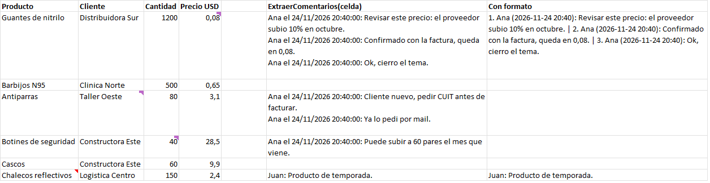
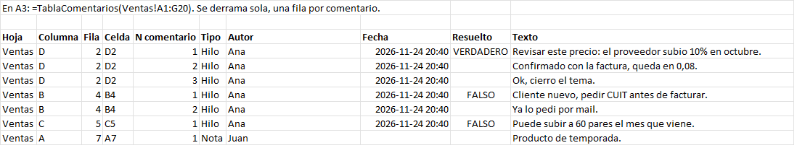
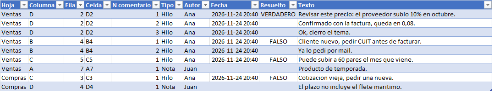
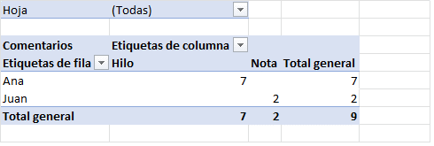

# 📝 Excel VBA: Extract, Analyze and Write Back Cell Comments
<p>
  <a href="README.md"></a>
  <a href="README.es.md"></a>
</p>

> **Excel has no formula to read a cell's comments. This module brings them into the grid, where they can be searched, filtered, counted and pivoted, and takes your edits back into the cells.**

[](VBA-comment-extractor.bas)
[](#-which-one-should-i-use)
[](#-tests)
[](https://github.com/mauroemartinez/VBA-extract-comments-function/releases)
[](LICENSE)
[](https://github.com/mauroemartinez/VBA-extract-comments-function/commits/main)

<p align="left">
  <a href="#-the-tools">🧰 Tools</a> ·
  <a href="#-which-one-should-i-use">🧭 Which one</a> ·
  <a href="#%EF%B8%8F-installation">⬇️ Install</a> ·
  <a href="#-the-tables-columns">📋 Columns</a> ·
  <a href="#-refreshing-and-limits">🔁 Limits</a> ·
  <a href="#%EF%B8%8F-problems-we-found-while-building-it">🛠️ Lessons</a> ·
  <a href="#-tests">✅ Tests</a> ·
  <a href="#%EF%B8%8F-changelog">🗒️ Changelog</a>
</p>

---

## 🧰 The tools

| Tool | What you get | Excel version |
|---|---|---|
| `=ExtraerComentarios(cell)` | All the comments of **one cell**, as text in that cell | Any |
| `=TablaComentarios([range])` | A **table**, one row per comment or reply, that spills by itself | 365 / 2021 |
| `ExportarComentarios` (macro) | Every comment of **every sheet**, in a new sheet as an Excel Table, ready for a PivotTable | Any |
| `ExportarComentariosConFiltro` (macro) | The same, only for **some sheets** or **some dates** | Any |
| `ImportarComentarios` (macro) | The way back: what you **edit in the table** is written into the cells | Any |

Every tool has an English alias with English headers: `=ExtractComments()`, `=CommentsTable()`, `ExportComments`, `ExportCommentsWithFilter` and `ImportComments`.

It reads both kinds of Excel comments: **threaded comments** (the modern ones, with replies) and **notes** (the classic yellow box). A cell with no comments stays empty, with no error.

### 1. One cell: `=ExtraerComentarios()`

<p align="center">
  
</p>

```
=ExtraerComentarios(D2)
=ExtraerComentarios(D2, "{n}. {author} ({date}): {text}", " | ")
=ExtraerComentarios(A7, "{author}: {text}")
```

| Argument | Required | What it does |
|---|---|---|
| `cell` | yes | The cell whose comments you want. If you pass a range, only its first cell is used. |
| `format` | no | A template for each comment, with `{author}`, `{date}` (`yyyy-mm-dd hh:mm`), `{text}` and `{n}` (1 is the thread, 2 and on are the replies). Without it, the output is the original one: `Author el date: text`. |
| `separator` | no | What goes between one comment and the next. By default, a line break (turn on *Wrap Text* to see it). |

### 2. A table that spills: `=TablaComentarios()`

<p align="center">
  
</p>

```
=TablaComentarios()                  every comment on the sheet where the formula is
=TablaComentarios(Ventas!A1:G20)     only the comments inside that range
```

Write it in one cell and Excel fills the rows below by itself, with headers. Leave empty space below and to the right, or you will get `#SPILL!`. Format the `Fecha` column as a date to read it: Excel returns dates from a function as numbers.

### 3. The whole workbook: `ExportarComentarios`

<p align="center">
  
</p>

Run it from **Developer > Macros** (or `Alt + F8`). It scans every sheet and writes all the comments in a sheet called **Comentarios**, as an Excel Table called `tblComentarios`, with the dates formatted and the text wrapped. Running it again **rewrites the same table in place**: it is never duplicated, and the PivotTables and formulas that use it keep working and refresh by themselves.

### 4. A PivotTable on top

<p align="center">
  
</p>

The sample workbook has a **Resumen** sheet with a PivotTable built on `tblComentarios`: comments by author and type, with a filter by sheet. It updates every time `ExportarComentarios` runs. From the same table you can answer *who comments the most*, *open threads by sheet* (filter `Resuelto` = FALSE) or *average comments per cell*.

### 5. Only some sheets or dates: `ExportarComentariosConFiltro`

Run it from `Alt + F8` and it asks three things: the sheets (separated by `;`, empty for all), the start date and the end date (empty for no limit). The end date includes the whole day. From another macro or from the Immediate window (`Ctrl + G`) you can skip the questions:

```vba
ExportarComentariosDe "Ventas;Compras"            ' two sheets
ExportarComentariosDe , #11/1/2026#, #11/30/2026# ' November only
ExportarComentariosDe "Ventas", Date - 7          ' Ventas, last week
```

Notes have no date in Excel, so a date filter leaves them out.

### 6. The way back: `ImportarComentarios`

Edit the table on the **Comentarios** sheet and run `ImportarComentarios`. The cells end up as the table says:

| You do this in the table | The macro does this in the cell |
|---|---|
| Change the `Texto` of a row | Rewrites that comment |
| Add a row with `Hoja`, `Celda`, `N comentario`, `Tipo` (`Hilo` or `Nota`) and `Texto` | Creates the comment (several rows with the same cell make a thread with replies) |
| Empty the `Texto` of every row of a cell | Deletes the comment |
| Change `Resuelto` to TRUE or FALSE | Marks or unmarks the thread as resolved |

Cells that did not change are **not touched**, so they keep their author and date, and cells that are not in the table are left alone. Running it twice changes nothing the second time. The status bar says how many cells were updated.

What Excel does not allow: changing the **author or date** of a threaded comment. New or rewritten threads are signed by whoever runs the macro, with today's date.

---

## 🧭 Which one should I use?

| Your situation | Use |
|---|---|
| You want to **read** the comments next to the data, row by row, or copy them into a report | **The function** `=ExtraerComentarios()` |
| You want the comments of **one sheet** as a table inside your model, next to other formulas (`FILTER`, `COUNTIF`, `XLOOKUP`) | **The spilling function** `=TablaComentarios()` (365 / 2021) |
| You want **every sheet** at once, a **PivotTable**, to **send** the comments to someone, or your Excel has no dynamic arrays | **The macro** `ExportarComentarios` |
| You only care about **one area** or **one period** (this month's review, one supplier's sheet) | `ExportarComentariosConFiltro` |
| You want to **review, fix or answer many comments at once**, or copy comments from one workbook to another | Export, edit the table, then `ImportarComentarios` |
| The workbook is **large** (thousands of comments) | **The macros**: they read everything once and write it in one go. Many functions dragged down recalculate one by one. |
| You need a **snapshot** that does not change (a month-end audit, for example) | **The macro**: its result is plain values in a table, not formulas |
| The workbook will be **shared with people who disable macros** | Run the macro, then save a copy as `.xlsx`: the table stays and the code goes away |

In short: **the function to read, the macros to analyze and to edit in bulk.**

---

## ⬇️ Installation

**Option A, import the file (recommended):**
1. Download [`VBA-comment-extractor.bas`](VBA-comment-extractor.bas) (or get it from the [latest release](https://github.com/mauroemartinez/VBA-extract-comments-function/releases/latest)).
2. In Excel, press `Alt + F11` to open the VBA editor.
3. **File > Import File...** and choose the `.bas`. A module called `ExtractorComentarios` appears.
4. Close the editor. The functions work in any cell and the macros appear in `Alt + F8`.

**Option B, copy and paste:** open the `.bas`, copy everything **from the second line on** (the first line, `Attribute VB_Name`, is only for importing), and paste it into a new module (**Insert > Module**).

Save the workbook as **Excel Macro-Enabled Workbook (`.xlsm`)**, or the code is lost.

**Try it first without installing anything:** download [`example/comments-example.xlsm`](example/comments-example.xlsm). It has invented data, threaded comments with replies, notes, every tool already in use, the PivotTable and the test module. Excel will ask you to enable macros.

---

## 📋 The table's columns

| Column | Example | Why |
|---|---|---|
| `Hoja` (Sheet) | `Ventas` | Filter by sheet |
| `Columna` (Column) | `D` | Index by column letter |
| `Fila` (Row) | `2` | Index by row number |
| `Celda` (Cell) | `D2` | The key to join back to the data |
| `N comentario` (Comment #) | `1`, `2`, `3` | `1` is the thread, the rest are replies in order |
| `Tipo` (Type) | `Hilo` / `Nota` | Threaded comment or classic note |
| `Autor` (Author) | `Ana` | Who wrote it |
| `Fecha` (Timestamp) | `2026-11-24 20:00` | When. Notes have no date in Excel, so it stays empty |
| `Resuelto` (Resolved) | `TRUE` / `FALSE` | Only on the first comment of a thread. Empty on replies and notes |
| `Texto` (Text) | `Check this price` | The comment itself. For notes, without the `Author:` line Excel adds at the top |

Rows come sorted by sheet, row, column and comment number.

---

## 🔁 Refreshing and limits

**Refreshing.** Excel **does not recalculate a formula when a comment changes**: adding or editing a comment is not a change in any cell. After you change comments, press **`Ctrl + Alt + F9`** (full recalculation) to refresh the functions. The macros are simply run again. The functions are deliberately **not volatile**: see the lessons below.

**Limits.**
- **Notes have no date**, and their author is only the display name of whoever created them.
- **Threaded comments are created in Microsoft 365.** Older versions show them as notes, and the tools read them as notes.
- **`TablaComentarios` needs dynamic arrays** (365 or 2021). In older versions, use the macro.
- **The single-cell function reads one cell.** If you pass `A1:C10`, it only looks at `A1`.
- **Resolved** exists only for threaded comments, and only on the first comment of the thread.
- **Importing cannot change the author or the date** of a threaded comment, only its text and replies.

---

## 🛠️ Problems we found while building it

- **A volatile function that reads comments can crash Excel when the workbook opens.** With `Application.Volatile`, Excel recalculated the table function while it was still loading the comments from the file, and Excel closed every time the sample opened. Without `Volatile` it opened every time. That is why the functions are not volatile and the README asks for `Ctrl + Alt + F9`.
- **An Excel Table cannot have the same name as a function.** The first version named the macro's table `TablaComentarios`, like the function, and the workbook stopped opening. The table is `tblComentarios` (`tblComments` in English).
- **Writing over a Table's headers invalidates the reference to it in VBA.** Rewriting the table in place failed with *Object required* until the macro looked the table up again by name after writing.
- **A PivotTable placed over existing text asks for confirmation** and blocks the macro. The sample's PivotTable starts below its title.
- **Excel creates a hidden note for every threaded comment.** Reading both collections counts each thread twice; notes that belong to a thread are skipped.
- **Notes start with `Author:`.** The table removes that line, because the author already has its own column. The single-cell function keeps the original behaviour unless you give it a format.

---

## ✅ Tests

[`tests/PruebasExtractor.bas`](tests/PruebasExtractor.bas) has **41 checks** that run inside Excel on the sample workbook:

- **The function:** text of a thread with replies, empty cells, notes, custom format and separator, English alias.
- **The spilling table:** headers, order, numbering, columns, *Resolved*, notes without a date, threads not counted twice, a range with no comments, English headers.
- **The export macro:** number of rows, Excel Table, real dates, running it twice does not duplicate, the PivotTable refreshes.
- **The filters:** one sheet, two sheets in any case, from a date (notes left out), an empty result without errors, an end date that includes the whole day.
- **The import macro:** nothing changes when nothing was edited, edited text, deleted comment, new thread, resolved thread, replies kept, a second run changes nothing, a full round trip of the workbook changes nothing.

Import it next to the main module and run `ProbarExtractor` from the Immediate window (`Ctrl + G`):

```
? ProbarExtractor()
```

Last run: **41 of 41 OK** on Excel for Microsoft 365 (Windows).

---

## 🗒️ Changelog

**v2.1 (November 2026)**
- New: `ImportarComentarios`, from the table back to the cells (edit, create, delete, resolve).
- New: `ExportarComentariosConFiltro` and `ExportarComentariosDe`, by sheet and by date.
- New: the export rewrites the table in place, so PivotTables and formulas built on it keep working and refresh.
- New: a PivotTable sheet in the sample workbook.
- Tests: from 22 to 41 checks.

**v2.0 (November 2026)**
- New: `=TablaComentarios()`, a table that spills, one row per comment or reply.
- New: the `ExportarComentarios` macro, every sheet into an Excel Table.
- New: English aliases with English headers.
- New: optional `format` and `separator` for the single-cell function.
- New: a sample workbook and a test module.
- Change: the default separator is a line break (`vbLf`) instead of `vbCrLf`, which Excel shows better inside a cell.

**v1.0**: `=ExtraerComentarios(cell)`.

## 🗺️ Roadmap

- [x] One comment per row, as a macro and as a spilling function.
- [x] English aliases.
- [x] A sample `.xlsm` with test comments.
- [x] A custom format for the single-cell function.
- [x] An `ImportarComentarios` macro, the way back: edit the table and write the comments into the cells.
- [x] Filter the macro by sheet or by date.
- [x] A ready-made PivotTable sheet in the sample.

Ideas and bug reports are welcome as [issues](https://github.com/mauroemartinez/VBA-extract-comments-function/issues).

## 📄 License

[MIT](LICENSE).
