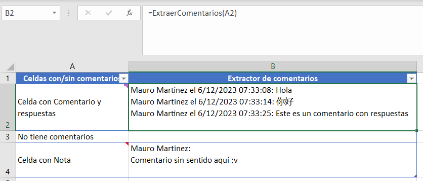
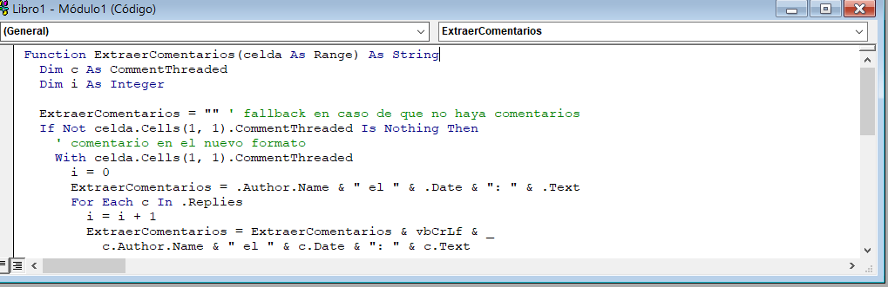

# 📝 Excel VBA: Extract Comments Function

### 📊 Preview in Use
**Context:** A custom VBA-based User Defined Function (UDF) designed to bridge a gap in native Excel functionality: the inability to extract cell comments (threaded or classic) directly into a cell using a formula.

  

> **Note:** As seen in the image above, the function is versatile and supports both **threaded conversations** (Office 365) and **classic notes**, ensuring no data is left behind regardless of the Excel version used. What's more, when there are no comments, it will leave the cell empty, no errors.

## 🚀 The Solution
This script creates a new Excel function: `=ExtraerComentarios()`. 
It works just like any native formula (SUM, VLOOKUP), but its purpose is to pull text data from metadata (comments) into the grid, making it searchable and exportable.

## 🛠️ Installation Guide (Step-by-Step)
You don't need to be a developer to use this. Just follow these steps:

1. **Get the Code:** Open the `.bas` file in this repository and copy the script (from the second line onwards).
2. **Open VBA Editor:** In your Excel file, right-click the Sheet tab name and select **"View Code"** (or press `ALT + F11`).
3. **Insert Module:** Go to the top menu: `Insert` > `Module`.
4. **Paste:** Paste the copied script into the new module window.
5. **Save & Return:** Close the VBA window to return to your Excel sheet.
6. **Apply:** Use the function in any cell: 
   `=ExtraerComentarios(A1)` (where A1 is the cell containing the comments).

## 💡 Key Features
* **Full Support:** Handles both modern Threaded Comments and legacy Notes.
* **UDF Integration:** Behaves like a native Excel function once installed.
* **Bulk Processing:** Extract data from hundreds of cells simultaneously by dragging the formula.

## 📸 Script Architecture
Visual representation of the implementation within the VBA Editor:

  

## 🗺️ Roadmap: one comment per row

A reader suggested the next step, and it is a good one: a single text per cell is fine to read, but hard to search, sort or count. The plan is to also offer a **comments table**, one row per comment or reply, ready for a PivotTable:

| Column | Example | Why |
|---|---|---|
| `Sheet` | `Ventas` | Filter by sheet |
| `Column` | `D` | Index by column letter |
| `Row` | `14` | Index by row number |
| `Cell` | `D14` | Column and row combined, the key to join back to the data |
| `Comment #` | `1`, `2`, `3` | `1` is the thread, the rest are replies in order |
| `Type` | `Threaded` / `Note` | Modern comment or legacy note |
| `Author` | `Ana` | Who wrote it |
| `Timestamp` | `2026-11-24 10:32` | When (legacy notes have no date in Excel, so it stays empty) |
| `Resolved` | `TRUE` / `FALSE` | Threaded comments can be marked resolved |
| `Text` | `Check this price` | The comment itself |

With that table, questions like *average comments per cell*, *last comment on a sheet*, *who comments the most* or *open threads by sheet* become one PivotTable or one formula.

**How it could be built (two options, both planned):**
1. **A macro** (`ExportarComentarios`) that scans every sheet (`CommentsThreaded` and `Comments`) and writes the rows into a new sheet as an Excel Table. Works in any version.
2. **A spilling function** (`=TablaComentarios(range)`) that returns the same table as a dynamic array. Needs Excel 365.

**Known limits to handle:**
- Excel does not recalculate a formula when a comment changes: the function would need `Application.Volatile` or a manual recalculation (F9); the macro simply runs again.
- Legacy notes carry no timestamp, and their author is only a display name.
- Large workbooks: write all rows in one array, not cell by cell, so it stays fast.

**Other ideas:**
- English function names as aliases (`ExtractComments`, `CommentsTable`) next to the Spanish ones.
- A sample `.xlsm` with test comments, so people can try it without copying code.
- An optional format for the current single-cell function (for example `{author} ({date}): {text}`).

Suggestions are welcome as issues.

---
**Note:** Remember to save your Excel file as **Excel Macro-Enabled Workbook (.xlsm)** to keep the function working.
